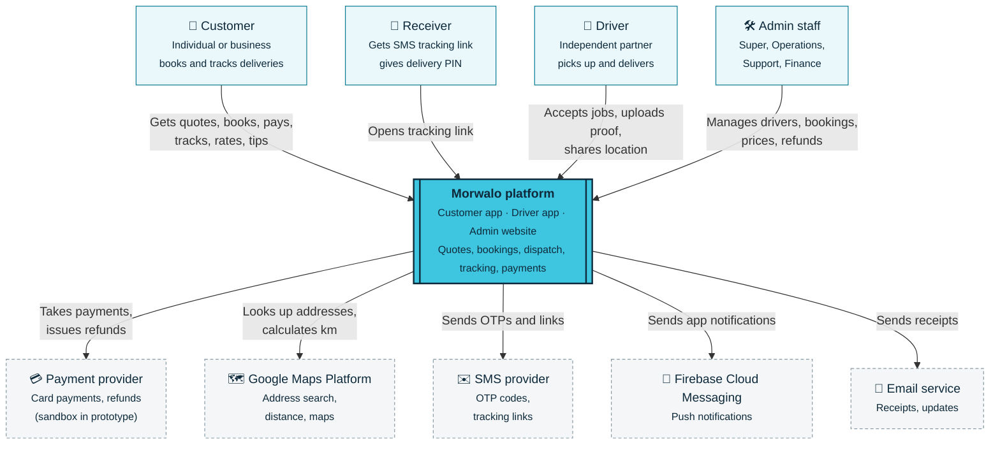

# 1. System context

Morwalo as one system, the people who use it, and the outside services it depends on.

## Legend

| Style | Meaning |
|---|---|
| Light cyan box | A person who uses Morwalo |
| Cyan box | The Morwalo platform (what we build) |
| Grey dashed box | An outside service Morwalo depends on (not built by us) |

## Notes

- In the prototype, payments run in **sandbox (test) mode** and SMS/OTP is **simulated** with a fixed test code.
- The receiver doesn't need the app. They only use the SMS tracking link and give the PIN to the driver.