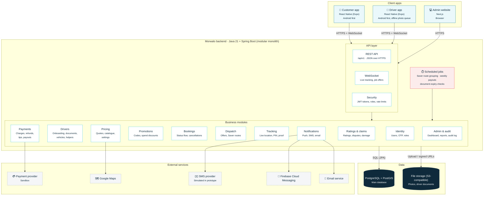

# 2. Architecture (containers)

What's inside the Morwalo platform: three client apps, one modular Spring Boot backend, the data stores and the external services.

## Why a modular monolith?

One deployable Spring Boot app, split into modules with clear boundaries. It is simpler to build, test and deploy for a small team than microservices. Each module owns its own tables and talks to other modules only through their public service interfaces, so any module can later be moved into its own service if Morwalo grows.

## Modules

| Module | Owns (data) | Main responsibilities | Related rules |
|---|---|---|---|
| Identity | users, roles, otp_codes | Sign-up, OTP login, JWT tokens, admin roles | BR-38, NFR-01–03 |
| Drivers | drivers, vehicles, helpers, documents | Onboarding, approval, suspension, document expiry | BR-39, BR-40 |
| Pricing | item_catalogue, pricing_settings, quotes | Volumetric weight, price formula, add-ons | BR-06–BR-14 |
| Promotions | promo_codes, promo_redemptions | Code validation, spend discounts, best-saving rule | BR-19–BR-25 |
| Bookings | bookings, booking_items, status_history | Status flow, cancellations, price changes | BR-27–BR-30 |
| Dispatch | job_offers, routes | Express offers, Saver route grouping, manual assign | FR-D03, FR-D04 |
| Tracking | location_pings, proofs | Live location, photos, delivery PIN | BR-31, NFR-07 |
| Payments | payments, refunds, tips, payouts | Charges, idempotency, splits, weekly payouts | BR-15–BR-18, BR-26 |
| Ratings & claims | ratings, claims, disputes | Two-way ratings, thresholds, damage claims | BR-32–BR-37 |
| Notifications | notifications | Push, SMS and email on status changes | FR-C12 |
| Admin & audit | audit_log | Dashboard, reports, CSV export, audit log | FR-A01, FR-A10 |

## Communication

| From → To | How |
|---|---|
| Apps → backend | REST over HTTPS (JSON), with a JWT token in each request |
| Backend → apps (live) | WebSocket for driver location and job offers; push notifications when the app is closed |
| Module → module | Direct Java service calls for queries; internal events (e.g. `BookingDelivered`) for side effects like notifications and payouts |
| Backend → database | Spring Data JPA; PostGIS for "drivers near this point" |