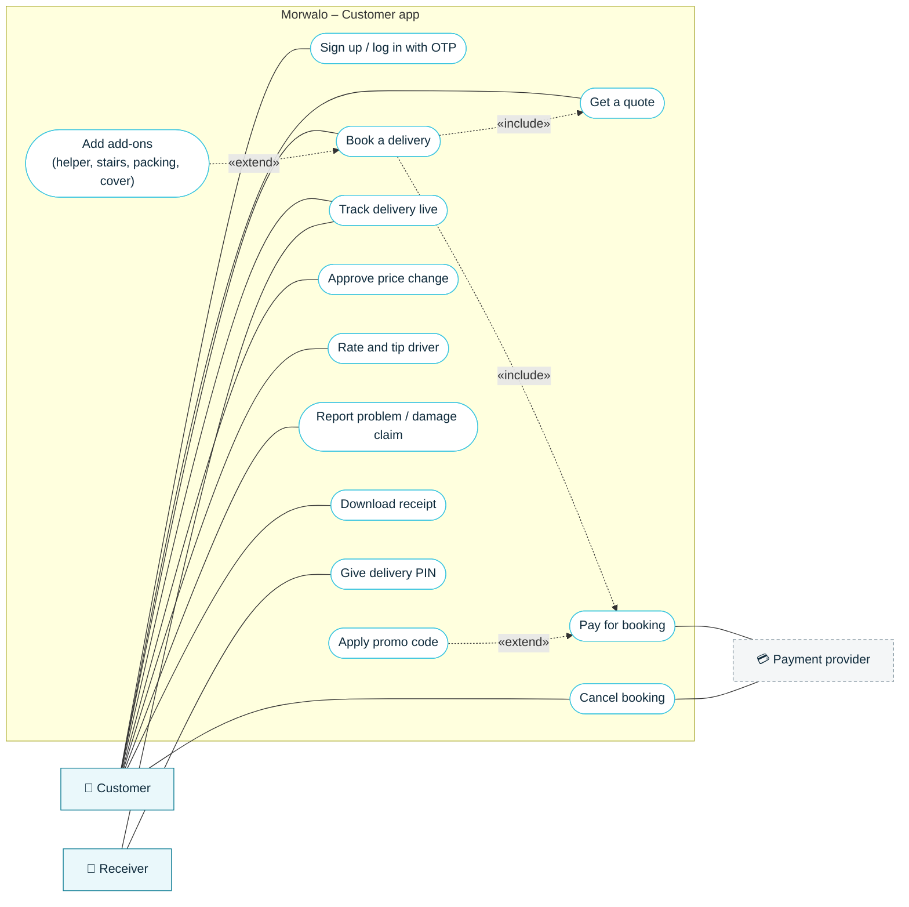
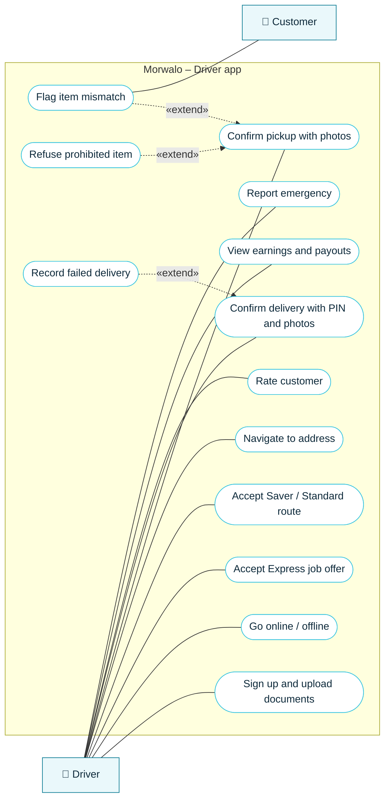
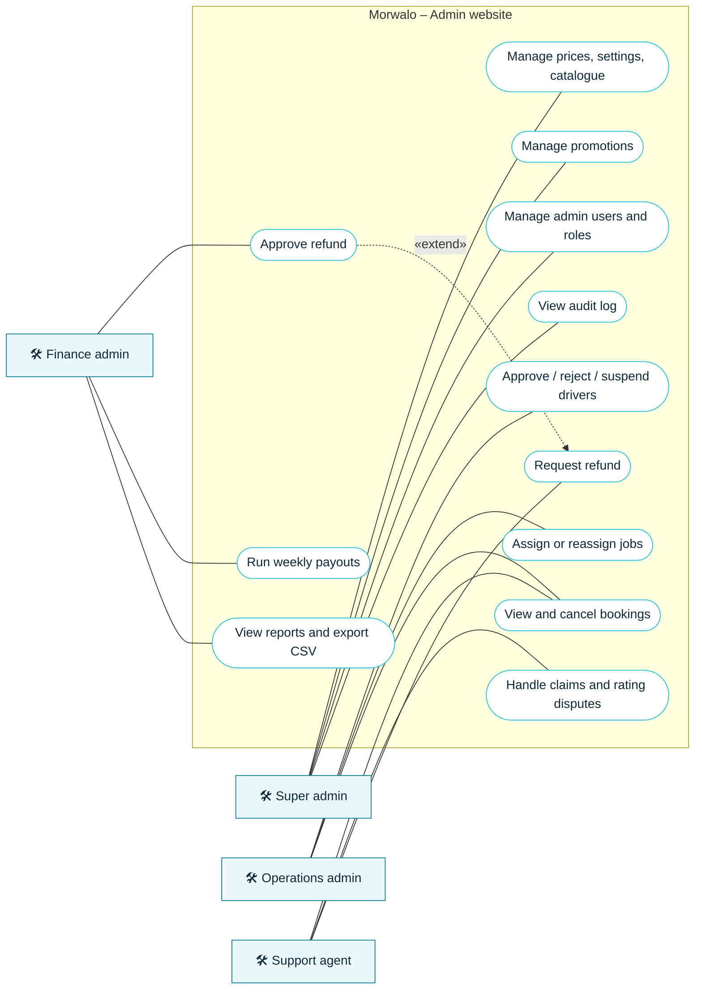

# 3. Use cases

What each actor can do in Morwalo. Use cases are drawn as rounded shapes inside the system boundary.
`«include»` = always happens as part of the use case. `«extend»` = optional extra behaviour.

## 3.1 Customer app

## 3.2 Driver app

## 3.3 Admin website

> **Note:** the Super admin can do **every** admin use case. Only their unique ones are linked above, to keep the diagram readable. The full permission matrix is in the BRD, section 5.