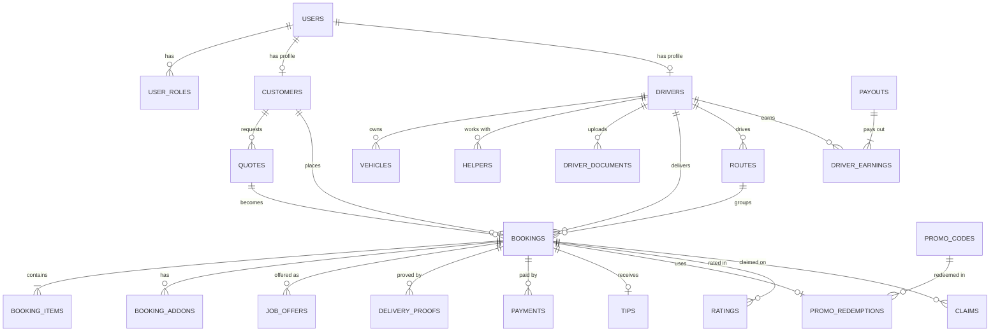
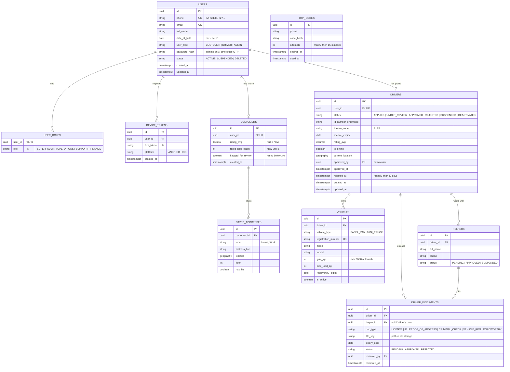
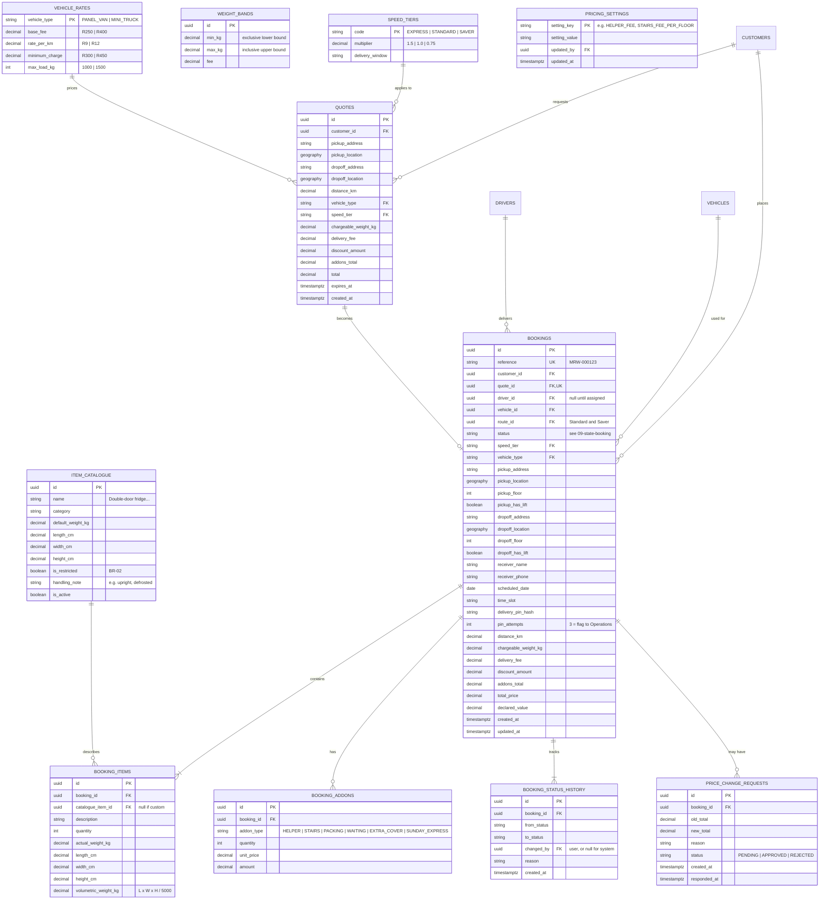
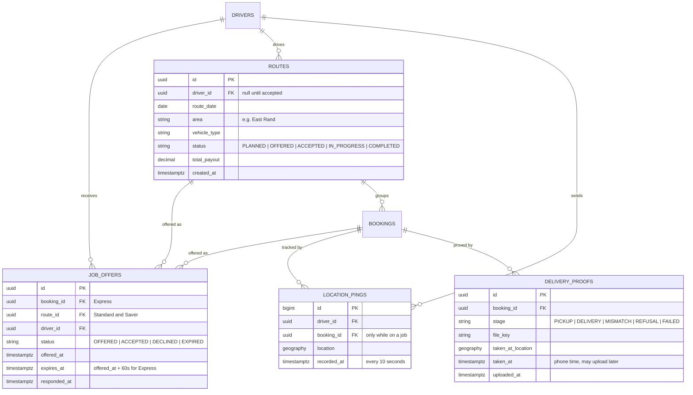
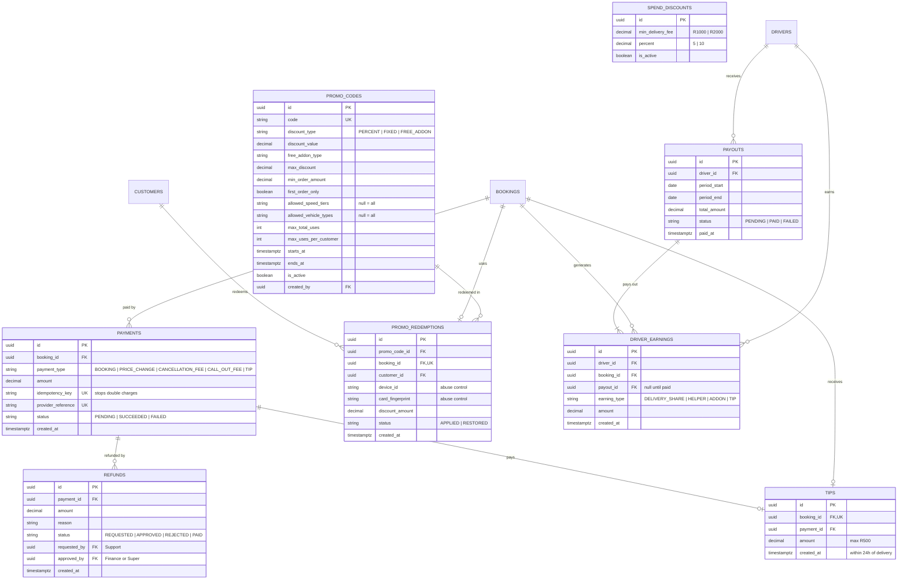
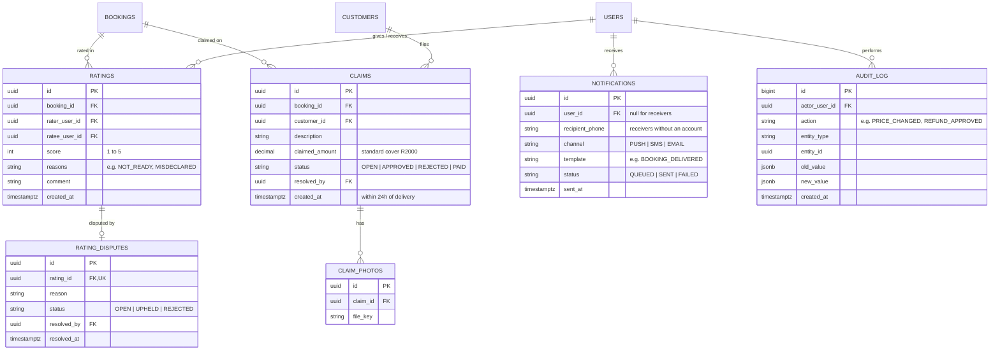

# 4. Entity relationship diagram (ERD)

PostgreSQL database design for Morwalo. Tables are grouped by the backend module that owns them (see [02-architecture.md](02-architecture.md)).

## Conventions

| Convention | Rule |
|---|---|
| Primary keys | `uuid`, generated by the backend (except `location_pings`, which uses `bigint` for speed) |
| Money | `decimal(10,2)` in rand (ZAR), VAT inclusive |
| Weights / sizes | kg and cm, `decimal(8,2)` |
| Time | `timestamptz` (stored in UTC, shown in South African time) |
| Locations | PostGIS `geography(Point, 4326)` |
| Status / type fields | Stored as text, checked against the allowed values listed in comments |
| Audit columns | Every table has `created_at`; editable tables also have `updated_at` |
| Sensitive data | ID numbers encrypted at rest; PINs and OTPs stored hashed, never in plain text |
| Settings | Prices, fees and limits live in tables, not code (NFR-19) |

## 4.1 Overview (main tables only)

## 4.2 Identity, customers and drivers

## 4.3 Pricing, quotes and bookings

## 4.4 Dispatch and tracking

## 4.5 Payments, promotions and payouts

## 4.6 Ratings, claims, notifications and audit

## Key constraints and indexes

| Table | Constraint / index | Why |
|---|---|---|
| `users` | Unique `phone`, unique `email` | One account per phone number (BR-38) |
| `bookings` | Unique `reference`; index on `(status, scheduled_date)` | Fast lookups and dispatch queries |
| `drivers` | GiST index on `current_location`; index on `(status, is_online)` | Find nearby online drivers |
| `ratings` | Unique `(booking_id, rater_user_id)` | One rating per person per job |
| `payments` | Unique `idempotency_key` | No double charges (BR-17) |
| `promo_redemptions` | Unique `booking_id` | One promo code per booking (BR-22) |
| `tips` | Unique `booking_id`; check `amount <= 500` | One tip per booking, max R500 (BR-26) |
| `ratings` | Check `score between 1 and 5` | Valid scores only |
| `location_pings` | Index on `(booking_id, recorded_at)`; delete after 90 days | Tracking history without growing forever (NFR-07) |