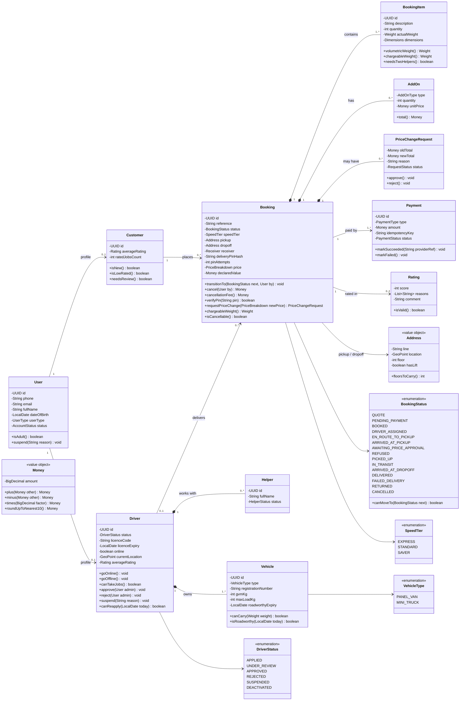
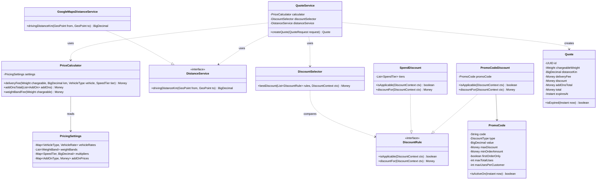

# 5. Domain class diagram

The main classes in the Morwalo backend (Java), showing where each business rule lives.
Database tables are in [04-erd.md](04-erd.md); this diagram is about behaviour.

## 5.1 Domain model

### Where the business rules live

| Rule | Class and method |
|---|---|
| Only allowed status changes (section 9 of BRD) | `BookingStatus.canMoveTo()`, called by `Booking.transitionTo()` |
| Cancellation fees (BR-29) | `Booking.cancellationFee()` |
| Delivery PIN, 3 attempts (BR-31) | `Booking.verifyPin()` |
| Volumetric and chargeable weight (BR-06, BR-07) | `BookingItem.volumetricWeight()`, `chargeableWeight()` |
| 2 helpers for items over 120 kg (BR-10) | `BookingItem.needsTwoHelpers()` |
| New customer until 5 rated jobs (BR-34) | `Customer.isNew()` |
| Low rating thresholds 3.5 / 3.0 (BR-35, BR-36) | `Customer.isLowRated()`, `needsReview()` |
| Reapply after 30 days (BR-40) | `Driver.canReapply()` |
| Rounding up to nearest R10 (BR-09) | `Money.roundUpToNearest10()` |

## 5.2 Pricing and promotions

### Design notes

- **Strategy pattern:** `PromoCodeDiscount` and `SpendDiscount` both implement `DiscountRule`. `DiscountSelector` asks each applicable rule for its discount and keeps the **biggest one** (BR-22: no stacking, customer gets whichever saves more). A new kind of discount later (e.g. a business volume discount) is just a new class, with no changes to existing code.
- **Interface for maps:** `DistanceService` is an interface, so tests can use a fake that returns a fixed distance (no Google API calls, no cost, repeatable tests).
- **Settings, not constants:** `PriceCalculator` reads every price from `PricingSettings`, which is loaded from the database (NFR-19).
- **Money as a value object:** amounts are never `double`. `Money` wraps `BigDecimal` so rounding is always correct.