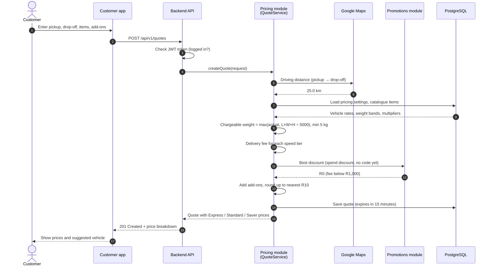
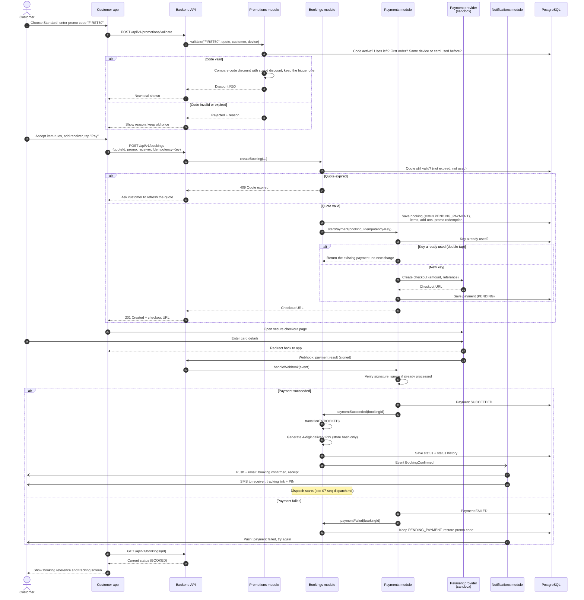

# 6. Sequence diagram – booking and payment

From getting a quote to a confirmed booking. Covers BR-06–BR-09 (pricing), BR-19–BR-25 (promotions) and BR-15–BR-17 (payment).

## 6.1 Get a quote

## 6.2 Book and pay

## Notes

| Step | Why it matters |
|---|---|
| Quote expires after 15 minutes | Prices and settings may change; the customer always pays a fresh, locked price (BR-16) |
| Promo checked against phone, device and card | Stops first-order promo abuse (BR-25) |
| `Idempotency-Key` header | Double taps or retries never create a second charge (BR-17) |
| Signed webhook | Only the real payment provider can confirm a payment |
| PIN stored as a hash | Even the database never holds the plain PIN (NFR-01) |
| `-)` arrows (async) | Notifications are sent in the background, so a slow SMS never delays the booking |