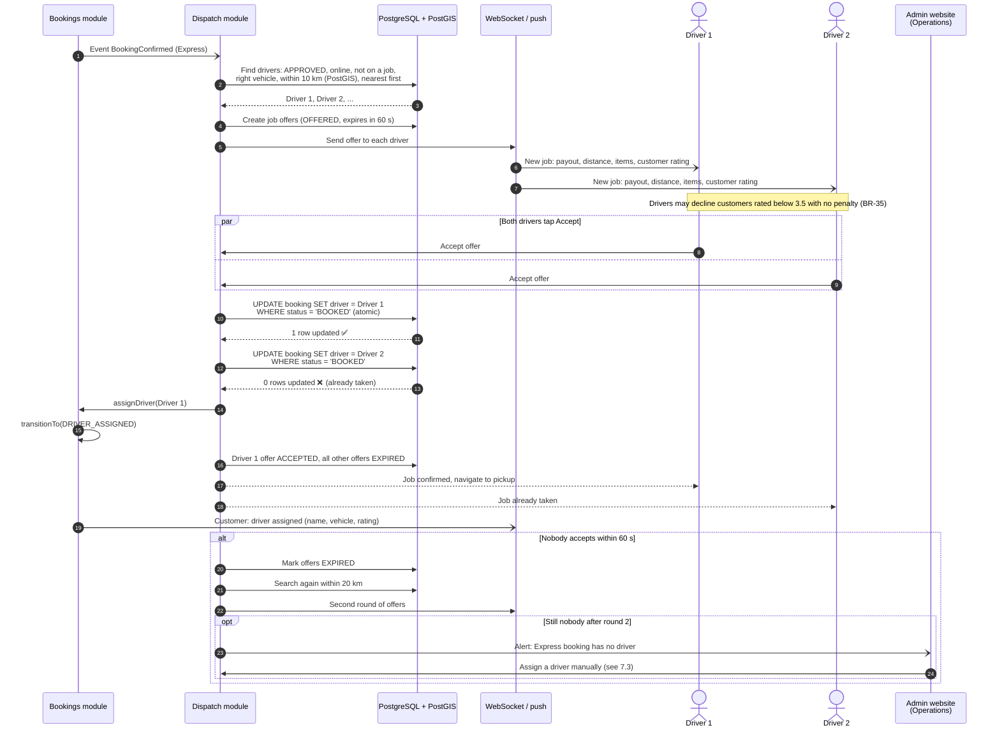
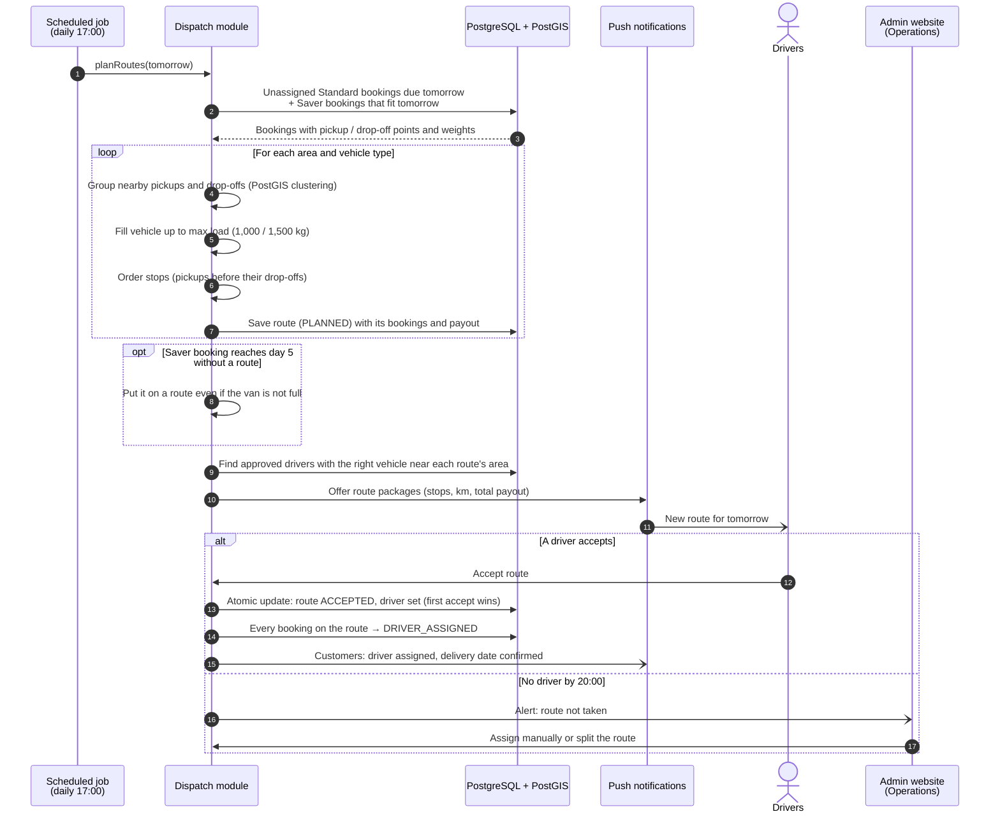
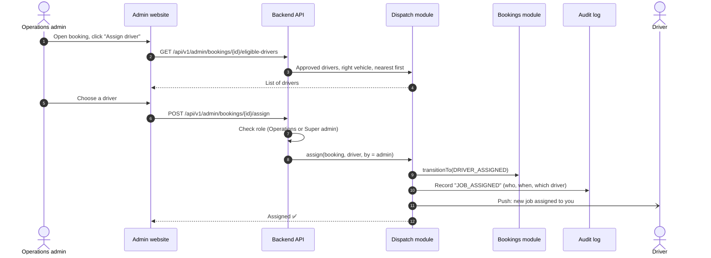

# 7. Sequence diagram – dispatch

How a booking gets a driver. Covers FR-D03, FR-D04, FR-A02 and BR-35.

## Dispatch settings (admin-editable)

| Setting | Starting value |
|---|---|
| First search radius (Express) | 10 km |
| Second search radius (Express) | 20 km |
| Drivers offered per round | Up to 5 nearest |
| Time to accept an Express offer | 60 seconds |
| Rounds before Operations is alerted | 2 |
| Route planning run (Standard and Saver) | Daily at 17:00, for the next day |
| Saver forced dispatch | Day 5 of the 7-day window |

## 7.1 Express – live offers

## 7.2 Standard and Saver – route packages

## 7.3 Manual assignment by Operations

## Notes

| Design choice | Reason |
|---|---|
| Atomic `UPDATE ... WHERE status = ...` | Prevents two drivers getting the same job, without slow locks |
| Offers expire after 60 s | Customers get a driver fast; unanswered offers don't block the job |
| Routes planned the evening before | Drivers can plan their day; customers get a confirmed date |
| Saver forced on day 5 | Keeps the "within 7 days" promise even when loads don't fill up |
| Every manual assignment audited | Admin actions are traceable (FR-A10) |