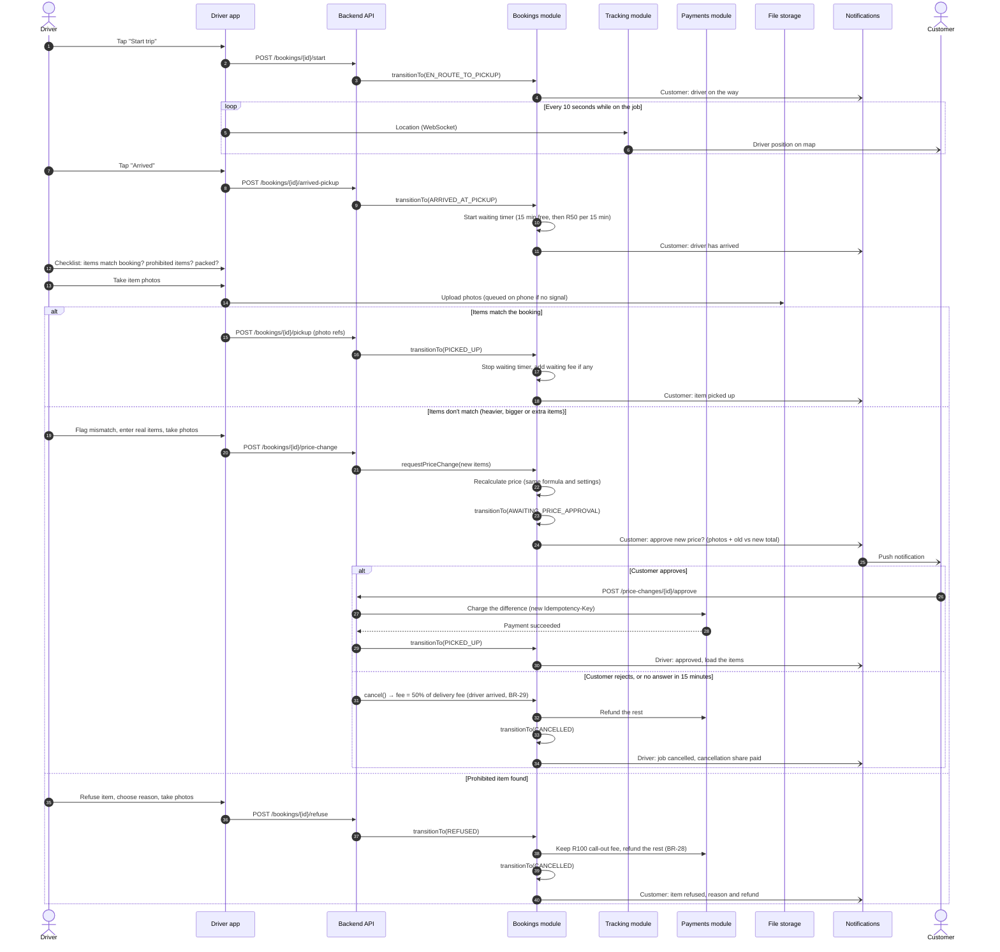
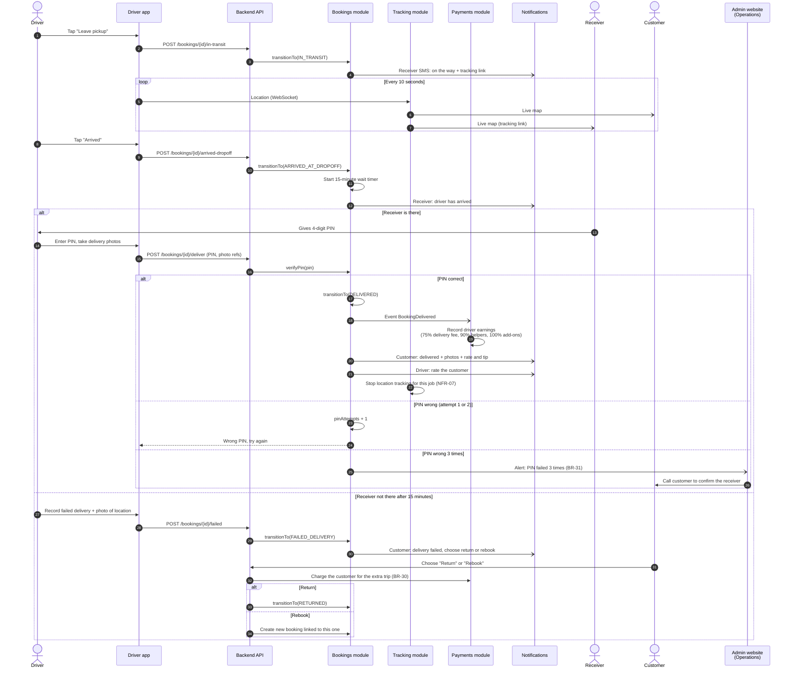

# 8. Sequence diagram – pickup and delivery

From the driver starting the trip to a completed delivery. Covers BR-04, BR-13, BR-27–BR-31, FR-D05–FR-D13 and NFR-07.

## 8.1 Pickup

## 8.2 Transit and delivery

## Notes

| Design choice | Reason |
|---|---|
| Photos at pickup and delivery, with GPS and phone time | Evidence for damage claims and disputes (BR-04, BR-32) |
| Offline photo queue | Drivers can finish jobs in areas with poor signal (FR-D13) |
| Price recalculated with the same formula | The customer sees a fair, explainable new price (BR-27) |
| 15-minute limit to approve a price change | The driver is not kept waiting forever |
| PIN checked by the backend, never by the app | The app never knows the real PIN, so it can't be bypassed |
| Earnings recorded on `BookingDelivered` | Drivers are only paid for completed jobs; payouts run weekly |
| Tracking stops at delivery | Location is tracked only while on a job (POPIA, NFR-07) |