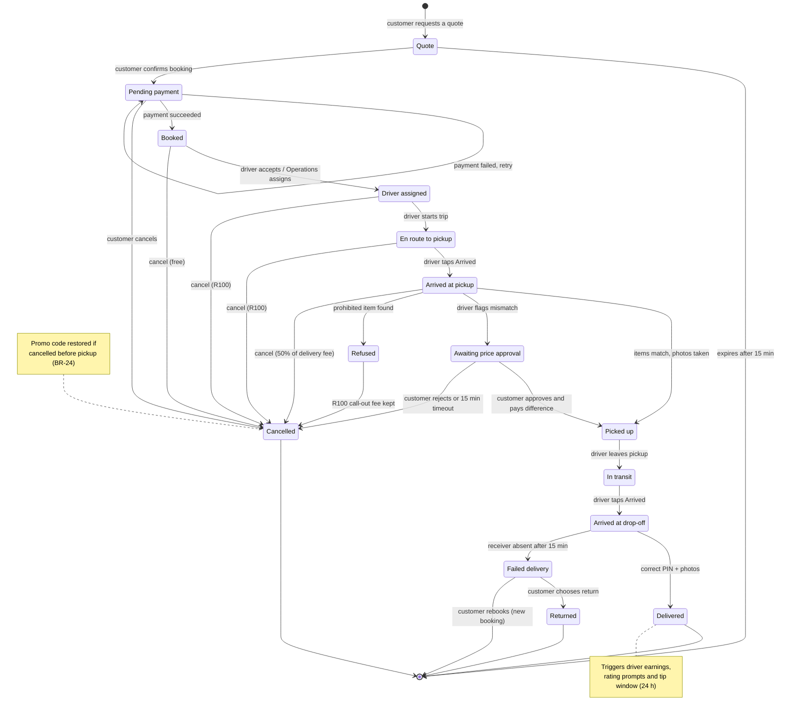

# 9. State diagram – booking status

Every status a booking can have and the only allowed moves between them. Any move not shown is rejected by `BookingStatus.canMoveTo()`.
See also: [06](06-seq-booking-payment.md), [07](07-seq-dispatch.md), [08](08-seq-pickup-delivery.md).

## Allowed transitions

| # | From | To | Who / what triggers it | Rule |
|---|---|---|---|---|
| T1 | Quote | Pending payment | Customer | – |
| T2 | Pending payment | Booked | Payment webhook | BR-15 |
| T3 | Booked | Driver assigned | Driver / Operations | FR-D03, FR-A02 |
| T4 | Driver assigned | En route to pickup | Driver | – |
| T5 | En route to pickup | Arrived at pickup | Driver | BR-13 (timer starts) |
| T6 | Arrived at pickup | Picked up | Driver | BR-04 |
| T7 | Arrived at pickup | Awaiting price approval | Driver | BR-27 |
| T8 | Awaiting price approval | Picked up | Customer | BR-27 |
| T9 | Awaiting price approval | Cancelled | Customer / timeout | BR-29 |
| T10 | Arrived at pickup | Refused | Driver | BR-28 |
| T11 | Refused | Cancelled | System | BR-28 |
| T12 | Picked up | In transit | Driver | – |
| T13 | In transit | Arrived at drop-off | Driver | – |
| T14 | Arrived at drop-off | Delivered | Driver + correct PIN | BR-31 |
| T15 | Arrived at drop-off | Failed delivery | Driver | BR-30 |
| T16 | Failed delivery | Returned | Customer | BR-30 |
| T17 | Pending payment → Arrived at pickup | Cancelled | Customer / Support / Operations | BR-29 |

## Cancellation fees by status (BR-29)

| Status when cancelled | Fee |
|---|---|
| Pending payment, Booked | Free |
| Driver assigned, En route to pickup | R100 |
| Arrived at pickup, Awaiting price approval | 50% of the delivery fee |
| Picked up or later | Cannot cancel |

## Examples of blocked moves (must be rejected)

| From | To | Why it's blocked |
|---|---|---|
| Delivered | In transit | A finished delivery can't restart |
| Booked | Picked up | Driver must be assigned and arrive first |
| Picked up | Cancelled | Items are already in the vehicle |
| Cancelled | Booked | A cancelled booking can't come back; book again |
| Quote | Booked | Payment is required first |