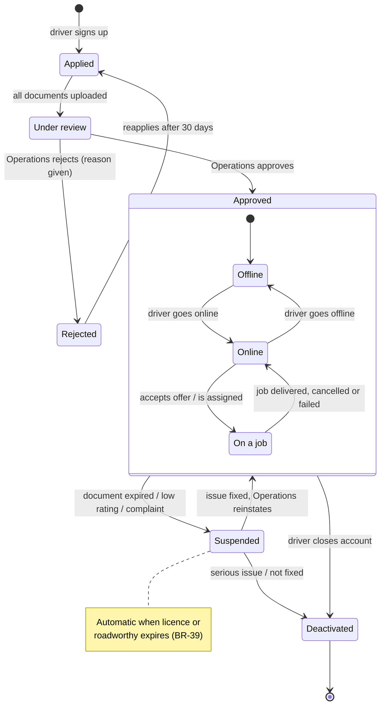

# 10. State diagram – driver account status

The life of a driver account, from sign-up to deactivation. While **Approved**, a driver also moves between **Offline**, **Online** and **On a job**.
Covers BR-36, BR-39, BR-40, FR-D01, FR-D02 and FR-A03.

## Allowed transitions

| From | To | Triggered by | Rule |
|---|---|---|---|
| Applied | Under review | System, when all required documents are uploaded | FR-D01 |
| Under review | Approved | Operations / Super admin | FR-A03 |
| Under review | Rejected | Operations / Super admin, with a reason | FR-A03 |
| Rejected | Applied | Driver, 30+ days after rejection | BR-40 |
| Approved | Suspended | System (expired document) or admin (low rating, complaint) | BR-36, BR-39 |
| Suspended | Approved | Operations, after a new document is approved or issue resolved | BR-39 |
| Suspended | Deactivated | Operations / Super admin | – |
| Approved | Deactivated | Driver request | – |

## Inside "Approved"

| From | To | Rule |
|---|---|---|
| Offline | Online | Only approved drivers can go online |
| Online | On a job | Accepts an Express offer or a route, or is assigned |
| On a job | Online | Job ends (delivered, cancelled, failed) |
| Online | Offline | Driver chooses; not allowed while on a job |

## Examples of blocked moves

| Attempt | Why it's blocked |
|---|---|
| Applied → Approved | Must be reviewed first |
| Rejected → Applied within 30 days | BR-40 |
| Suspended → Online | Suspended drivers can't take jobs |
| On a job → Offline | Driver must finish or hand back the job first |
| Deactivated → anything | Final state; a new application is needed |