# 11. Activity diagram – price calculation

The exact steps `QuoteService` follows to price a delivery. Covers BR-05–BR-14 and BR-19–BR-23.
All amounts come from the pricing settings tables, not from code.

```mermaid
flowchart TD
    start(["Start: quote request"]) --> v1{"Pickup and drop-off<br/>in service area?"}
    v1 -- No --> e1(["❌ Reject: outside service area"])
    v1 -- Yes --> v2{"At least one item?<br/>Any prohibited item?"}
    v2 -- "No items / prohibited" --> e2(["❌ Reject with reason"])
    v2 -- OK --> loop

    subgraph loop["For each item"]
        direction TB
        i1["Volumetric weight =<br/>L × W × H (cm) ÷ 5000"] --> i2["Item chargeable weight =<br/>max(actual, volumetric) × quantity"]
    end

    loop --> w1["Total chargeable weight =<br/>sum of items, minimum 5 kg"]
    w1 --> veh{"Fits in a panel van?<br/>(≤ 1,000 kg)"}
    veh -- Yes --> vv["Suggest panel van<br/>(customer may pick mini truck)"]
    veh -- No --> veh2{"Fits in a mini truck?<br/>(≤ 1,500 kg)"}
    veh2 -- Yes --> vt["Mini truck required"]
    veh2 -- No --> e3(["❌ Too heavy: split into<br/>more than one booking"])
    vv --> dist
    vt --> dist

    dist["Get driving distance (km)<br/>from Google Maps"] --> band["Weight band fee:<br/>5–30 kg R0 · 30.01–100 R150<br/>100.01–300 R350 · 300.01–1,500 R700"]
    band --> sub["Subtotal = base fee + km × rate per km + band fee"]
    sub --> min{"Subtotal below<br/>vehicle minimum charge?"}
    min -- Yes --> useMin["Use minimum charge"]
    min -- No --> keep["Keep subtotal"]
    useMin --> mult
    keep --> mult
    mult["Delivery fee = amount × speed multiplier<br/>Express 1.5 · Standard 1.0 · Saver 0.75"]

    mult --> disc{"Promo code entered?"}
    disc -- Yes --> pc["Validate code: active, dates, uses left,<br/>first order, tier / vehicle, abuse checks"]
    disc -- No --> sp
    pc --> sp["Work out spend discount:<br/>≥ R1,000 → 5% · ≥ R2,000 → 10%"]
    sp --> best["Discount = the bigger of code and spend discount<br/>(never both), capped at max discount,<br/>never more than the delivery fee"]

    best --> add["Add-ons"]
    subgraph addons["Add-ons (never discounted)"]
        direction TB
        a1{"Any single item<br/>over 120 kg?"} -- Yes --> a2["Helpers = at least 2"]
        a1 -- No --> a3["Helpers = as chosen"]
        a2 --> a4["Helpers × R150"]
        a3 --> a4
        a4 --> a5["Stairs: floors × R50<br/>(pickup + drop-off, no lift)"]
        a5 --> a6["Packing: items × R100"]
        a6 --> a7{"Declared value<br/>over R2,000?"}
        a7 -- Yes --> a8["Extra cover = 2% of value above R2,000"]
        a7 -- No --> a9["No extra cover"]
        a8 --> a10{"Sunday Express?"}
        a9 --> a10
        a10 -- Yes --> a11["+ R100"]
        a10 -- No --> a12["+ R0"]
    end
    add --> addons
    addons --> tot["Total = delivery fee − discount + add-ons"]
    tot --> round["Round UP to the nearest R10"]
    round --> save["Save quote, valid for 15 minutes"]
    save --> done(["✅ Return price breakdown"])

    classDef reject fill:#FDECEC,stroke:#E5484D,color:#0E2A3B
    classDef ok fill:#EAF8FB,stroke:#0B7B93,color:#0E2A3B
    class e1,e2,e3 reject
    class done ok
```

## Worked examples (use as test cases)

| # | Input | Steps | Total |
|---|---|---|---|
| 1 | Fridge 90 kg, 25 km, panel van, Standard, 1 helper | R250 + R225 + R150 = R625 × 1.0 = R625; + R150 | **R775** |
| 2 | Same, Saver | R625 × 0.75 = R468.75; + R150 = R618.75 → round up | **R620** |
| 3 | Box 3 kg, 2 km, panel van, Standard | Chargeable 5 kg (minimum); R250 + R18 + R0 = R268 → below minimum | **R300** |
| 4 | Fridge 90 kg, 25 km, panel van, Express, code "FIRST50" (R50 off) | R625 × 1.5 = R937.50; spend discount R0; code R50 → R887.50 | **R890** |
| 5 | Item 130 kg, customer chose "I'll help" | Rule forces 2 helpers = R300 added | (helpers R300) |

## Boundary values to test

| Rule | Test values |
|---|---|
| Minimum chargeable weight | 4.99 kg → 5 kg; 5 kg; 5.01 kg |
| Weight bands | 30.00 → R0; 30.01 → R150; 100.00 → R150; 100.01 → R350; 300.00 / 300.01 |
| Vehicle limits | 1,000 kg (van) / 1,000.01 kg (truck); 1,500 kg / 1,500.01 kg (reject) |
| Two-helper rule | 120 kg (no) / 120.01 kg (yes) |
| Spend discount | R999.99 (0%) / R1,000 (5%) / R1,999.99 / R2,000 (10%) |
| Extra cover | Declared R2,000 (none) / R2,000.01 |
| Rounding | R770.00 → R770; R770.01 → R780 |