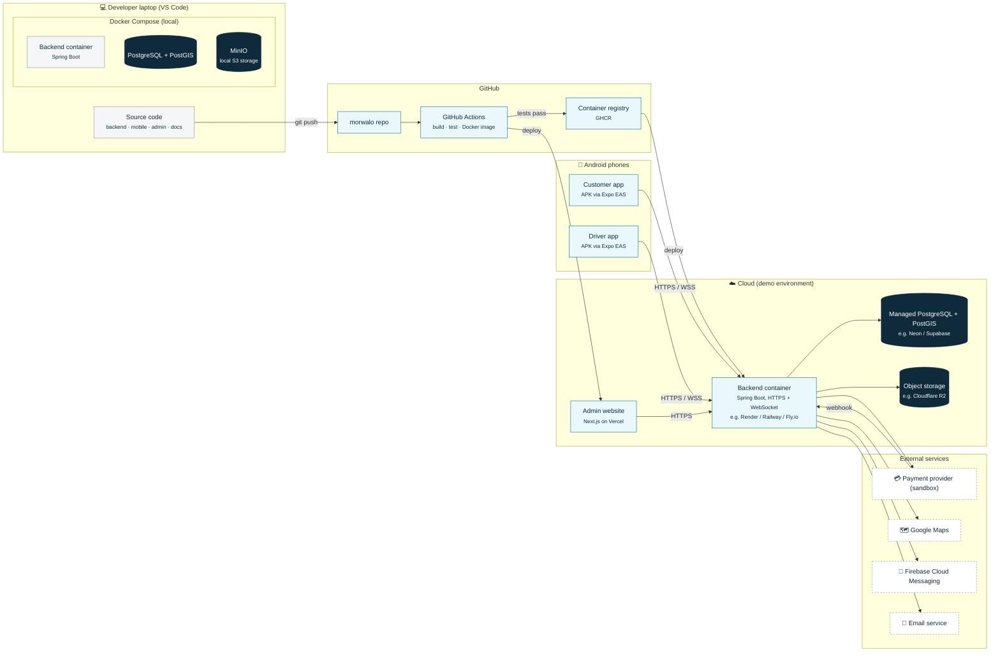
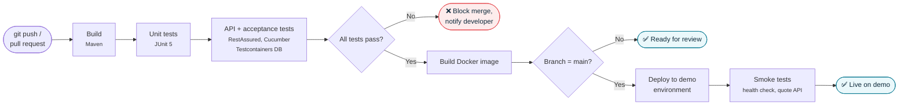

# 12. Deployment diagram

Where each part of Morwalo runs, and how code goes from a laptop to the cloud.
Hosting options below are **candidates** (free or low-cost tiers) to be confirmed before building.

## 12.1 Environments

| Environment | Purpose | Where |
|---|---|---|
| Local | Day-to-day development and tests | Developer laptop, Docker Compose |
| Demo (staging) | Shared prototype for demos and portfolio | Cloud, sandbox payments, test data |
| Production | Real customers (later, at pilot stage) | Cloud, real payments, backups, monitoring |

## 12.2 Prototype deployment

## 12.3 CI/CD pipeline

## Notes

| Choice | Reason |
|---|---|
| Docker everywhere | The backend runs the same on a laptop and in the cloud |
| Testcontainers in CI | API tests run against a real PostgreSQL + PostGIS, not a fake |
| Secrets in GitHub / host settings | API keys and passwords are never committed to the repo |
| APKs via Expo EAS | Testers install the apps directly; Google Play internal testing later |
| Backups and monitoring | Added for production at the pilot stage |